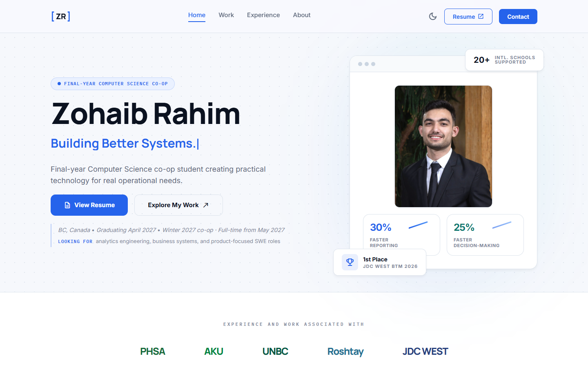

# Zohaib Rahim — Portfolio Site

Static, framework-free portfolio for Zohaib Rahim, a final-year BSc Computer Science (Co-op) student at UNBC.

**Live:** [zohaibrahim.vercel.app](https://zohaibrahim.vercel.app)



Graduating April 2027 · **Winter 2027 co-op · Full-time from May 2027** — analytics engineering, business systems, and product-focused software engineering roles.

---

## What this demonstrates

- **Static-first performance** — one HTML document, a ~44 KB minified stylesheet, a few KB of hand-written JS; the hero image is the LCP with `fetchpriority="high"` and fixed dimensions (no CLS).
- **Accessibility (WCAG 2.2 AA target)** — keyboard-operable tabs and modals (arrow keys, Esc to close, focus trapped and returned), visible focus rings, `prefers-reduced-motion` respected, and dark mode synced before first paint (no flash).
- **No-framework approach** — vanilla HTML5 and ES2020; no React, no bundler, no hydration.
- **Tailwind build** — Tailwind CSS 3.4 compiled once by the CLI (`npm run build`) instead of the runtime CDN.
- **Vercel deploy** — `vercel.json` runs the build and serves the repo root with clean URLs.

---

## Site contents

- **Hero** — static tagline with a CSS-only reveal, résumé and work CTAs, availability line, headshot card with metric chips.
- **Organization strip** — PHSA, AKU, UNBC, Roshtay, JDC West.
- **Project portfolio** — 18 projects across three tabs (Data & BI: 6, Business Systems: 4, Software: 8); 9 are featured and the rest sit in a collapsed, keyboard-accessible "More work" `<details>` section on each tab. Each opens an accessible case-study modal with Overview, results, Approach, My Contribution, Design Decision, technologies and evidence links. Modals without a real screenshot show no media slot.
- **Professional experience** — Roshtay (founder), Aga Khan University, PHSA.
- **About** — Education, Location and Availability cards; Skills, Education, Certificates and Leadership tabs.
- **JDC West 2026** — 1st place, Business Technology Management, with verification links.
- **Contact and footer**, plus a custom `404.html`.

---

## Tech stack

| Layer | Choice |
|---|---|
| Markup | Vanilla HTML5 (`index.html` + `404.html`) |
| Styling | Tailwind CSS 3.4 + `@tailwindcss/forms`, `@tailwindcss/container-queries`; scoped rules in an inline `<style>` block |
| Icons | Material Symbols Outlined (Google Fonts) |
| Fonts | Inter (body), Manrope (headlines), IBM Plex Mono (technical labels) |
| JavaScript | Vanilla ES2020 IIFE — tabs, modals, focus trap, scroll-spy, theme toggle, gallery, mobile drawer |
| Build | `npm run build` (Tailwind CLI) |
| Hosting | Vercel, static, `outputDirectory: "."` |

---

## Project structure

```
Personal Website/
├── index.html          # Markup, inline CSS and inline JS for the whole site
├── 404.html            # Brand-matched not-found page
├── styles.css          # GENERATED by Tailwind — do not hand-edit
├── styles.input.css    # Tailwind input
├── tailwind.config.js  # Design tokens
├── robots.txt / sitemap.xml
├── vercel.json         # buildCommand, cleanUrls, outputDirectory
├── .vercelignore       # Keeps source files, scripts and private files out of the deploy
├── Assets/
│   ├── Icons/          # apple-touch-icon, Azure cert badge
│   ├── Images/         # Project screenshots, headshot, og-card.png (_source/ = PNG masters, not deployed)
│   ├── Resume/         # Zohaib_Rahim_Resume_Portfolio.pdf (linked from the site)
│   └── Certificates/   # Certificate PDFs (reference only, not deployed)
└── scripts/
    ├── optimize_assets.py   # Image optimizer + og-card / apple-touch-icon generator
    ├── dump_docs.py         # Dumps résumé text for fact-checking (output is git-ignored)
    └── screenshots/         # Audit captures and the README screenshot
```

---

## Getting started

**Requirements:** Node.js 18+, Python 3.9+ (only to regenerate images).

```bash
# clone
git clone https://github.com/ZohaibRahim/portfolio-website.git
cd portfolio-website

# install Tailwind + plugins
npm install

# build styles.css once
npm run build

# or watch for changes during development
npm run watch

# serve locally (any static server works)
python -m http.server 5500
# → open http://localhost:5500
```

There's no framework, no HMR and no dev server. Edit `index.html`, run the build if you added Tailwind classes, refresh.

---

## Where to edit what

All content lives in `index.html`; search for these markers rather than line numbers:

- **Meta, Open Graph, Twitter, JSON-LD `Person`, canonical** — top of `<head>`.
- **Hero, availability line** — `<section id="hero">`.
- **Project cards** — `id="tab-data"`, `id="tab-digital"`, `id="tab-software"`.
- **Project modal content** — `const projectDetails` in the script block (one entry per `data-project-id`); tab order in `const projectOrder`.
- **Experience timeline** — `<section id="experience">`.
- **About cards and tabs** — `<section id="about">`; coursework in `const coursework`.
- **JDC West block, contact, footer** — the sections after `#self-directed`.

**Accuracy rule:** every metric, date, title and claim on the site must trace to the master résumé. Don't invent, round or "improve" numbers.

---

## Accessibility

- Skip link to `#main`; semantic landmarks.
- Focus rings kept via `focus-visible` styles.
- Modals and the mobile drawer: `role="dialog"`, `aria-modal`, focus trap, Esc to close, focus returned to the trigger.
- Tabs: `role="tablist"/"tab"/"tabpanel"` with arrow-key navigation and `aria-selected`.
- `prefers-reduced-motion`: the tagline reveal and cursor blink are disabled.
- Alt text on every image.

---

## Deploy (Vercel)

```json
{
  "$schema": "https://openapi.vercel.sh/vercel.json",
  "buildCommand": "npm run build",
  "outputDirectory": ".",
  "cleanUrls": true,
  "trailingSlash": false
}
```

On every push Vercel runs `npm install`, then `npm run build`, and serves the repo root. The canonical domain is **zohaibrahim.vercel.app** — it is used by the canonical link, Open Graph/Twitter tags, JSON-LD, `robots.txt` and `sitemap.xml`.

---

## Asset pipeline

`scripts/optimize_assets.py` resizes and re-encodes project screenshots, regenerates `apple-touch-icon.png`, and draws `og-card.png` (1200×630). Add new images to the `tasks` list in `main()` and run:

```bash
python scripts/optimize_assets.py
```

`scripts/dump_docs.py` dumps the résumé source documents to text so site copy can be checked against them; its output (`scripts/_docs_dump.txt`) is git-ignored.

---

## License

The code is not open-sourced. Content, design and brand assets are © 2026 Zohaib Rahim. Third-party dependencies keep their own licenses (Tailwind CSS — MIT; Material Symbols — Apache 2.0; Inter, Manrope, IBM Plex Mono — SIL Open Font License).

## Contact

- **Portfolio** — [zohaibrahim.vercel.app](https://zohaibrahim.vercel.app)
- **LinkedIn** — [linkedin.com/in/zohaibrahim](https://linkedin.com/in/zohaibrahim)
- **GitHub** — [github.com/zohaibrahim](https://github.com/zohaibrahim)
- **Email** — see the Contact section on the site
